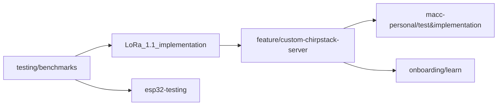

# PQ MQTT mTLS for IoT LoRa

Post-quantum cryptography for IoT and LoRaWAN: what it costs on small devices, and a LoRaWAN system in which every
MQTT link uses post-quantum TLS. **`main` holds only this page.** The code is on the branches below.

```bash
git clone -b <branch> https://github.com/cthyuiii/PQ_MQTT_mTLS_for_IoT_LoRa.git
# the ChirpStack branches (feature/custom-chirpstack-server, macc-personal/...) also need: --recurse-submodules
```

Had `main` checked out before 25 Oct 2026? Its code is now on `testing/benchmarks`:
`git fetch && git switch testing/benchmarks`.

## Where each branch comes from



Each branch carries the one before it, unless it says it strips files.

## `testing/benchmarks`: the benchmark suite

`main`'s code until 25 Oct 2026. Benchmarks on a MacBook, a Raspberry Pi 4 / 5 and a Pico W / Pico 2 W:

- PQC signatures (key generation, signing, verification) and key exchange;
- payload protection: LoRaWAN's AES-CTR + CMAC, AES-GCM, Ascon;
- TLS and mutual-TLS handshakes with PQ certificates, and MQTT over them;
- the pipeline from the PQ handshake to a protected payload at the MQTT broker;
- deployment checks: CRLs, revoked and expired certificates, a signed trust-anchor update.

`./run_all.sh` runs all of it. `docs/how_it_works.md` has the library map and each stage's calls; results are in
`docs/findings.md`.

## `LoRa_1.1_implementation`: the LoRaWAN 1.1 chain with the stock ChirpStack

The benchmark suite plus the network side:

- **The chain:** Pico W → a virtual gateway (no radio) → ChirpStack → the application, every MQTT hop on PQ mutual
  TLS. Mosquitto bridges carry the hops the stock ChirpStack can't, so there is no plain MQTT anywhere.
- **An AES-256 end-to-end layer** inside the LoRaWAN payload (`lorawan11_e2e`), which passes through ChirpStack and
  only the application decrypts.
- **A round trip,** Pico → application → Pico, with each layer timed.

Findings 115-127.

## `feature/custom-chirpstack-server`: the team's prototype

ChirpStack built from our fork ([cthyuiii/chirpstack](https://github.com/cthyuiii/chirpstack), branch `iot-pqc`, a
submodule at `network/chirpstack`), so that ChirpStack itself does PQ TLS. It uses TLS 1.3 with X25519MLKEM768 and
ML-DSA-44 certificates on both sides, straight to the broker on the Pi (finding 128). The Gateway Bridge does the same
once rebuilt with Go 1.27, with no code change (finding 129). The benchmark files the server doesn't use are stripped.

Teammates branch from here: `git switch -c <your-name>/<topic> feature/custom-chirpstack-server`.

## `macc-personal/test&implementation`: macc's own tests

The prototype's code, where new parts are built and tested first. Please don't push here. On top of the prototype:

- the Gateway Bridge on the same PQ broker as ChirpStack and the application;
- the radio gateway: a Pi 5 with an SX1303 HAT and Semtech's packet forwarder (`docs/radio_gateway.md`);
- AES-256 LoRaWAN: the plan, the rules and the test vectors for LoRaWAN 1.0.3, 1.0.4 and 1.1, with ABP and OTAA
  (`docs/aes256_lorawan.md`).

## `onboarding/learn`: labs for new team members

Eight hands-on labs (`learn/README.md`). They go from where the algorithms come from, through certificates and the
TLS handshake, to LoRaWAN frames, our 256-bit layer and benchmarks. Only Docker is needed, on any laptop. The labs
run in a Debian container, which clones this repository itself. Only the files the labs use are kept.

## `esp32-testing`: the benchmarks on an ESP32

The benchmark suite with Stage 1, Stage 2 and the pipeline ported to an ESP32 (`docs/esp32_build_notes.md`).

## License

MIT, see [LICENSE](LICENSE).
