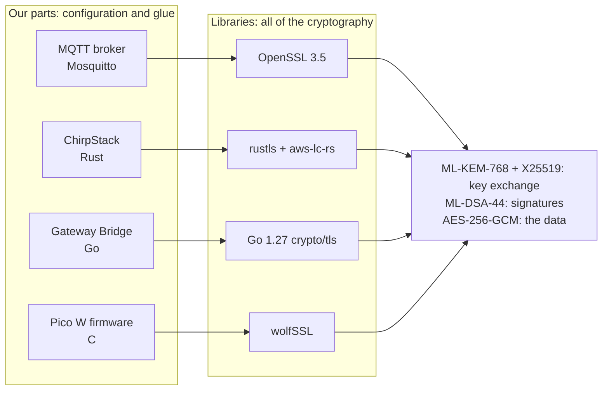

# Lab 1 — Nobody here writes cryptography

Every post-quantum algorithm in this project comes from an existing, reviewed library. Our work is choosing the
library, configuring it and joining the parts together. We change a library's settings only when something doesn't
fit (the Pico W's memory), and never the algorithms themselves.



## Step 1: what is already inside OpenSSL?

**Predict:** does OpenSSL need a plug-in to do ML-KEM and ML-DSA?

```bash
openssl list -kem-algorithms | grep -i ml-kem
openssl list -signature-algorithms | grep -i ml-dsa
openssl list -tls-groups -tls1_3 | tr : '\n' | grep -i mlkem
```

<details><summary>Answer</summary>

No. Since OpenSSL 3.5 (April 2025) ML-KEM-512 / 768 / 1024 and ML-DSA-44 / 65 / 87 are built in (the "default"
provider, marked `@ default`). The TLS 1.3 groups include pure ML-KEM and three hybrids: `SecP256r1MLKEM768`,
`X25519MLKEM768` and `SecP384r1MLKEM1024`. Before 3.5 you needed oqs-provider, a plug-in from the Open Quantum Safe
project; `main`'s benchmarks still use it for algorithms OpenSSL doesn't have (Falcon, MAYO, SNOVA).

</details>

## Step 2: who does the cryptography for each part?

| Part | Library | What we changed |
|---|---|---|
| MQTT broker on the Pi (Mosquitto) | OpenSSL 3.5 | configuration only: TLS 1.3, the certificates, the key-exchange groups |
| ChirpStack (Rust) | rustls, with aws-lc-rs doing the maths | one Cargo feature and 3 lines of code (step 3) |
| ChirpStack Gateway Bridge (Go) | Go 1.27's standard library | nothing: rebuilt with a newer Go; its key saved in seed-only form (lab 2) |
| Pico W firmware | wolfSSL | wolfSSL's own small-memory switches (step 4) |
| AES-256 LoRaWAN, the 256-bit inner layer | OpenSSL, the Ascon reference code | the only parts we design: we combine library primitives |

**Predict:** if a bug were found in an ML-KEM implementation tomorrow, which files of ours would change?

<details><summary>Answer</summary>

None of our code. We would update the library (OpenSSL, aws-lc-rs, Go or wolfSSL) to the fixed version and rebuild.
The last row is different: the AES-256 LoRaWAN change and the inner layer are our own combinations, so they are what
needs the most review and testing.

</details>

## Step 3: our whole ChirpStack change

ChirpStack is about 115,000 lines of Rust. Our version is a fork on GitHub, `cthyuiii/chirpstack`, and the change is
one commit, `b4d894d1`. **Predict:** how many lines did we change to give it post-quantum TLS?

```bash
cd /lab
curl -sL https://github.com/cthyuiii/chirpstack/commit/b4d894d1.patch -o pq.patch
sed -n '/^---$/,/^$/p' pq.patch                    # the files and lines changed
sed -n '/^diff --git a\/Cargo.toml/,$p' pq.patch   # the change itself, without Cargo.lock
```

<details><summary>Answer</summary>

Three files: `Cargo.toml` (two features swapped, one version raised), `main.rs` (5 lines, 2 of them a comment) and
`Cargo.lock` (the resolved versions).

- `ring` → `aws_lc_rs`: rustls itself does no cryptography; a "provider" does. ring has no ML-KEM or ML-DSA;
  aws-lc-rs (AWS's libcrypto) has both.
- `prefer-post-quantum`: puts X25519MLKEM768 first in the ClientHello (lab 3).
- `0.23.44`: the first rustls whose aws-lc-rs provider accepts ML-DSA certificates.
- `install_default()`: two of ChirpStack's dependencies still pull in ring, so two providers are compiled in, and
  rustls won't guess which one to use. `main()` picks aws-lc-rs before any connection is opened.

</details>

## Step 4: when something doesn't fit

The Pico W has 264 KB of RAM, and its Arduino core gives a program an 8 KB stack. **Predict:** to run ML-DSA on it,
did we rewrite ML-DSA, swap the library, or something else?

```bash
grep -n -E 'SMALL_STACK|SMALL_MEM' pico/sketches/wolfssl_bench/wolfssl_user_settings.h
```

<details><summary>Answer</summary>

Something else: we only switched on wolfSSL's own options. `WOLFSSL_SMALL_STACK` moves big buffers from the stack to
the heap; `WOLFSSL_MLDSA_MAKE_KEY_SMALL_MEM`, `..._SIGN_SMALL_MEM` and `..._VERIFY_SMALL_MEM` select wolfSSL's
low-memory code paths. It's the same algorithm with the same results; it uses less RAM and runs slower.

</details>

## Check yourself

1. Which project ships the ML-KEM code that ChirpStack runs?
2. Why couldn't ChirpStack do post-quantum TLS before our change, although rustls supports it?

<details><summary>Answers</summary>

1. AWS: aws-lc-rs is the Rust wrapper around AWS-LC, AWS's cryptography library (derived from Google's BoringSSL).
2. ChirpStack had chosen the ring provider, which has no post-quantum algorithms. The capability was in rustls all
   along, behind a different provider.

</details>

Next: [lab 2, keys and certificates](02-certificates.md).
