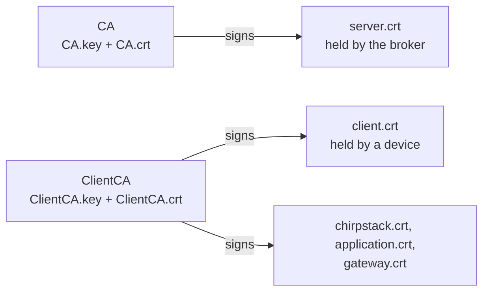
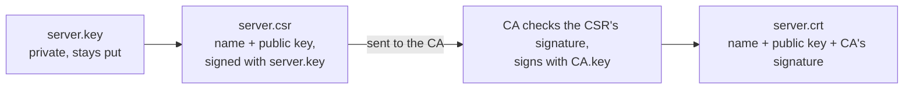

# Lab 2 — Keys and certificates

A **certificate** is a public key plus a name, signed by a CA. Our setup has **two CAs**, as in
`scripts/gen_certs.sh`:

- `CA` signs the **broker's** certificate. Every client trusts `CA.crt`, so it can check it reached the real broker.
- `ClientCA` signs the **devices'** certificates. The broker trusts `ClientCA.crt`, so it can check who is connecting.



Each certificate is signed once, when it's made. Then in every handshake the device checks the broker's certificate
against `CA.crt`, and the broker checks the device's against `ClientCA.crt`.

All commands run in the container.

## Step 1: two CAs

```bash
mkdir -p /lab/certs && cd /lab/certs
openssl genpkey -algorithm ML-DSA-44 -out CA.key
openssl req -x509 -new -key CA.key -out CA.crt -days 30 -subj "/CN=Lab CA"
openssl genpkey -algorithm ML-DSA-44 -out ClientCA.key
openssl req -x509 -new -key ClientCA.key -out ClientCA.crt -days 30 -subj "/CN=Lab client CA"
```

`-x509` makes the CA's certificate **self-signed**: nobody above it vouches for it. It is trusted because you copy
`CA.crt` to each client yourself.

**Predict:** an RSA-2048 certificate is roughly 1 KB, an ECDSA P-256 one roughly 0.5 KB. How big is an ML-DSA-44
certificate?

```bash
openssl x509 -in CA.crt -outform DER | wc -c
```

<details><summary>Answer</summary>

About 3,975 bytes (yours differs by a few). It holds an ML-DSA-44 public key (1,312 bytes) and an ML-DSA-44
signature (2,420 bytes); the name, dates and extensions are the small rest. A device receives the broker's
certificate in every handshake, so that size goes over its network link each time.

</details>

## Step 2: the broker's certificate — key, CSR, signature



```bash
openssl genpkey -algorithm ML-DSA-44 -out server.key
openssl req -new -key server.key -out server.csr -subj /CN=localhost
openssl req -in server.csr -noout -text | grep -E 'Subject:|Algorithm'
```

**Predict:** is the private key inside the CSR? If not, how does the CA know that whoever sent it owns the key?

```bash
openssl req -in server.csr -noout -verify
```

<details><summary>Answer</summary>

No. A CSR holds the name and the **public** key, signed with the private key. `-verify` checks that signature: only
the owner of the private key could have made it ("self-signature verify OK"). That's why a CSR can be emailed, and the
private key never has to leave the machine that made it.

</details>

Now the CA turns the CSR into a certificate, with the names the broker may be reached by (its SAN):

```bash
openssl x509 -req -in server.csr -CA CA.crt -CAkey CA.key -CAcreateserial -days 30 -out server.crt \
  -extfile <(echo subjectAltName=DNS:localhost,IP:127.0.0.1)
openssl x509 -in server.crt -noout -text | grep -E 'Issuer:|Subject:|Algorithm|DNS:|Not After'
```

## Step 3: a device's certificate

```bash
openssl genpkey -algorithm ML-DSA-44 -out client.key
openssl req -new -key client.key -out client.csr -subj /CN=lab-device
openssl x509 -req -in client.csr -CA ClientCA.crt -CAkey ClientCA.key -CAcreateserial -days 30 -out client.crt
```

**Predict:** which of these three checks fail?

```bash
openssl verify -CAfile CA.crt server.crt
openssl verify -CAfile CA.crt client.crt
openssl verify -CAfile ClientCA.crt client.crt
```

<details><summary>Answer</summary>

Only the second: `unable to get local issuer certificate` (error 20). `client.crt` was signed by `ClientCA`, and
`CA.crt` can't vouch for it. So a device certificate can never pass as the broker's, and the other way round.

</details>

## Step 4: what's in a private key file?

An ML-DSA key pair can be stored two ways: as the 32-byte **seed** it is made from, or **expanded** (2,560 bytes,
the form the signing maths uses). OpenSSL saves both by default.

```bash
ls -l *.key                                            # mode 600: only the owner can read it
openssl pkey -in client.key -noout -text | grep -E '^[a-z]+:'
openssl pkey -in client.key -outform DER | wc -c       # seed + expanded
openssl pkey -in client.key -provparam ml-dsa.output_formats=seed-only -outform DER | wc -c   # seed only
openssl pkey -in client.key -provparam ml-dsa.output_formats=seed-only -out seed.key
```

**Predict:** `seed.key` holds 32 secret bytes. Read it back and write it out in the default form: do you get your
original 2,626-byte key, a different one, or an error?

```bash
openssl pkey -in seed.key -outform DER | wc -c
openssl pkey -in client.key -outform DER | sha256sum
openssl pkey -in seed.key -outform DER | sha256sum
```

<details><summary>Answer</summary>

The original, byte for byte: 2,626 bytes and identical hashes. The file has three parts (`seed:`, `priv:`, `pub:`);
the seed-only form is 54 bytes. OpenSSL rebuilt the expanded key and the public key from the seed. Making the key from
the seed is **deterministic**: the same seed always gives the same key pair. So the seed is the real secret, and the
expanded key is a cache. Go 1.27 (our Gateway Bridge) reads only the seed-only form; that's why the gateway's key is
converted with this command (finding 129).

</details>

## Who keeps what

| File | Secret? | Lives on | Used for |
|---|---|---|---|
| `CA.key` | yes | only the CA's machine | signing broker certificates, once each |
| `ClientCA.key` | yes | only the CA's machine | signing device certificates, once each |
| `server.key` | yes | the broker | signing in every handshake (lab 3) |
| `client.key` | yes | the device | signing in every handshake |
| `*.crt`, `*.csr` | no | anywhere | they are sent in the clear (a CSR) or inside every handshake (a certificate) |

`scripts/gen_certs.sh` runs exactly these steps (key → CSR → CA signs) for every signature type, all on one machine
(the CA's), and then copies the device and broker keys out; the copy to the broker leaves the CA keys behind. In a real deployment each
device makes its own key and sends only the CSR. You'll do that in lab 5.

## Check yourself

1. Someone copies `server.crt` off the broker. What can they do with it?
2. Someone steals `ClientCA.key`. What can they do, and what fixes it?

<details><summary>Answers</summary>

1. Nothing useful: the broker sends it to every client anyway. To pretend to be the broker they also need
   `server.key`, to make the handshake signature (lab 3).
2. Issue themselves device certificates the broker accepts, under any name. Revoking certificates doesn't help (they
   just make new ones): the client CA has to be replaced, and every device given a new certificate. That's why the
   CA keys never leave the CA's machine.

</details>

Next: [lab 3, one handshake, message by message](03-handshake.md).
