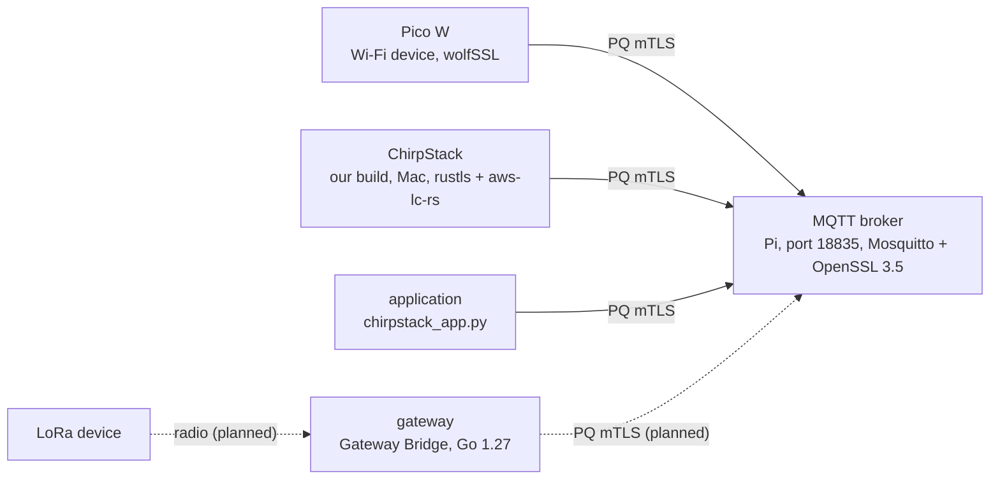

# Lab 5 — Our system

## The architecture



"PQ mTLS" = TLS 1.3, X25519MLKEM768, ML-DSA-44 certificates on both sides: labs 2 and 3, with these machines in
place of your container.

- **One broker in the middle.** Wi-Fi devices, ChirpStack and the application all connect to it, and none of them
  connect to each other. ChirpStack publishes the LoRa devices' data there, and takes commands for them from there.
- **The gateway** (dotted) is the next step. A LoRa device can't do TLS over the radio; LoRaWAN's own AES protects
  that hop, and the gateway's link to the broker is where TLS starts.

## Who holds which key

| Private key | Lives on | Its certificate is signed by |
|---|---|---|
| `CA.key` | the Mac only: the copy to the Pi leaves it out | (itself: it signed the broker's `server.crt`) |
| `ClientCA.key` | the Mac only | (itself: it signed every certificate below) |
| `server.key` | the Pi, the broker | `CA` |
| `client.key` (`pqc-client`) | built into the Pico W's firmware | `ClientCA` |
| `chirpstack.key` | the Mac, inside ChirpStack's container | `ClientCA` |
| `application.key` | the Pi, the application | `ClientCA` |

All of them are made on the Mac (`scripts/gen_certs.sh`, `scripts/chirpstack_pq_setup.sh`) and copied out. That's
fine for a test bed. In a deployment each device makes its own key and sends only a CSR, as you'll do below.

## Check yourself

1. TLS ends at the broker. Who can read a Pico's message in plain text?
2. Which links are post-quantum today, and which aren't?
3. Someone breaks into the Pi. What do they get, and what don't they get?

<details><summary>Answers</summary>

1. **The broker.** TLS protects each link, not the whole path: the broker decrypts what arrives and re-encrypts it
   for each subscriber. That's why the LoRa data carries an inner 256-bit layer that only the application can open;
   ChirpStack and the broker pass it on without the key.
2. Post-quantum: Pico ↔ broker, ChirpStack ↔ broker, application ↔ broker (though the broker also accepts classical
   clients, lab 4 #7). Not yet: ChirpStack's link to its own Mosquitto for gateway traffic (ECDSA certificates,
   inside Docker on the Mac), and the radio hop (LoRaWAN's AES-128 with our 256-bit layer inside; AES-256 LoRaWAN is
   planned).
3. They get `server.key` (they can pretend to be the broker until its certificate is replaced) and every message that
   passes through while they're in. The application runs on the Pi too, so they also get `application.key` and the
   inner layer's key. And because the test bed copies `certs/` whole, they'd find a copy of the Pico's `client.key`;
   in a deployment that key would exist only on the device. They **don't** get the CA keys, which stay on the Mac, so
   they can't issue themselves new certificates.

</details>

## Your own certificate on the real broker (on site, on the lab network)

The real CSR flow: your private key never leaves your container.

**1. You:** make a key and a CSR, and copy the CSR out.

```bash
cd /lab
openssl genpkey -algorithm ML-DSA-44 -out me.key
openssl req -new -key me.key -subj /CN=learn-<your name> -out me.csr
exit                                   # then, on your machine:
docker cp pqc-lab:/lab/me.csr learn-<your name>.csr
```

Send `learn-<your name>.csr` to macc. Only the CSR.

<details><summary>2. macc: check and sign it (the Mac, repo root)</summary>

```bash
O=$(brew --prefix openssl@3)/bin/openssl; C=certs/MLDSA44
$O req -in learn-<name>.csr -noout -verify -subject
$O x509 -req -in learn-<name>.csr -CA $C/ClientCA.crt -CAkey $C/ClientCA.key -CAcreateserial -days 7 -out learn-<name>.crt
```

Send back `learn-<name>.crt` and `certs/MLDSA44/CA.crt`. Seven days, because the broker has no revocation list
switched on yet (the CRL is paused): a certificate can't be taken back, only left to expire.

</details>

**3. You:** copy them in, then connect to the real broker.

```bash
docker cp learn-<your name>.crt pqc-lab:/lab/me.crt
docker cp CA.crt pqc-lab:/lab/broker-CA.crt
docker start -ai pqc-lab
cd /lab
B="-h 192.168.50.133 -p 18835 --cafile broker-CA.crt --cert me.crt --key me.key"
mosquitto_sub $B -t 'pqc/learn/#' -v &
sleep 2; mosquitto_pub $B -t pqc/learn/<your name> -m "hello from <your name>"
openssl s_client -connect 192.168.50.133:18835 -CAfile broker-CA.crt -cert me.crt -key me.key -trace \
  < /dev/null 2>&1 | grep -E '^ +[A-Za-z]+, Length=|NamedGroup: |^Verify return' | cut -c1-70
```

You see everyone's `pqc/learn/` messages, and the same handshake as lab 3, now with the Pi. Keep to `pqc/learn/`:
the broker's access list (ACL) is paused too, so it won't stop you from writing anywhere else.

## Where to go next

- [Lab 6, a LoRaWAN frame byte by byte](06-lorawan-frame.md): what protects the radio hop, where TLS can't.

- `docs/findings.md` 127-129: the ChirpStack and Gateway Bridge work, with the captures.
- The open work (gateway, AES-256 LoRaWAN, the broker's group list): `docs/pending.md` on
  `macc-personal/test&implementation`.
