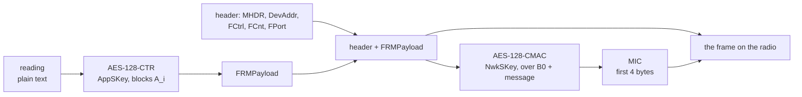

# Lab 6 — A LoRaWAN frame, byte by byte

A LoRa device can't do TLS over the radio, so each frame protects itself. A LoRaWAN 1.0.x data frame:

```text
| MHDR | DevAddr | FCtrl | FCnt | FPort | FRMPayload      | MIC |
|  1   |    4    |   1   |  2   |   1   | n, encrypted    |  4  |   bytes
'------------- the 9-byte header, readable -------------'
```

Two keys protect it:

- **AppSKey** encrypts the payload (AES-128 in counter mode, CTR).
- **NwkSKey** makes the **MIC**: 4 bytes of an AES-128-CMAC over the header and the encrypted payload. A receiver that
  computes the same 4 bytes knows the frame is unchanged and came from someone holding the key.

The gateway checks neither: it only forwards. ChirpStack (network and application server in one) holds both keys.

How a device builds one, and what the receiver checks:



The receiver does it in reverse: it recomputes the MIC (a mismatch means drop the frame), checks that FCnt went up,
then decrypts.

You'll take apart a real frame: the example from the lora-packet library's README, which `network/app_aead.c` (the
project's frame code) checks itself against. All commands run in the container, in `/lab`. Your setup already
installed `xxd`; if not: `apt-get install -y xxd`.

```bash
cd /lab
APPSKEY=ec925802ae430ca77fd3dd73cb2cc588
NWKSKEY=44024241ed4ce9a68c6a8bc055233fd3
FRAME=40F17DBE4900020001954378762B11FF0D
```

## Step 1: read the header

```bash
echo $FRAME | sed -E 's/^(..)(.{8})(..)(.{4})(..)(.*)(.{8})$/MHDR=\1 DevAddr=\2 FCtrl=\3 FCnt=\4 FPort=\5 FRMPayload=\6 MIC=\7/'
```

**Predict:** someone with a LoRa receiver hears this frame. What can they learn without any key?

<details><summary>Answer</summary>

```text
MHDR=40 DevAddr=F17DBE49 FCtrl=00 FCnt=0200 FPort=01 FRMPayload=95437876 MIC=2B11FF0D
```

The whole header:

- **MHDR 40:** an unconfirmed uplink (`60` would be a downlink).
- **DevAddr:** the device's address, lowest byte first, so ChirpStack shows it as `49BE7DF1`.
- **FCnt 0200:** frame number 2, also lowest byte first.
- **FPort 01:** which application stream it belongs to.

The receiver also sees the payload's length (4 bytes). It can't read the payload, and it can't change anything
without breaking the MIC. The header has to stay readable: the network server needs DevAddr to find the right keys.

</details>

## Step 2: decrypt the payload

CTR mode turns AES into a keystream: AES encrypts a 16-byte **block**, and the result is XORed with the data. LoRaWAN
builds each block from the frame itself:

```text
first byte | 00000000 | Dir (00 up, 01 down) | DevAddr | FCnt (4 bytes) | 00 | last byte
```

For encryption the first byte is `01` and the last is the block number (A_1, A_2, ...). Type this helper once; labs 6
and 7 use it:

```bash
block() { echo "$1"00000000"$2$DEVADDR$FCNT"00"$3"; }   # block <first> <dir> <last>
DEVADDR=F17DBE49         # as it is in the frame
FCNT=02000000            # FCnt 2 as 4 bytes, lowest first
block 01 00 01
echo 95437876 | xxd -r -p | openssl enc -aes-128-ctr -K $APPSKEY -iv $(block 01 00 01) | xxd
```

**Predict:** why does the block contain DevAddr and FCnt?

<details><summary>Answer</summary>

It decrypts to `test`. DevAddr and FCnt make every frame's keystream different: no two devices and no two frames of
one device ever share it. Step 5 shows what happens when they do.

</details>

## Step 3: check the MIC

The MIC is a CMAC under NwkSKey over block **B0** followed by the message (header + encrypted payload). B0 has the
same layout with first byte `49`, and its last byte is the message's length: 9 + 4 = 13 = `0D`.

```bash
block 49 00 0D
echo $(block 49 00 0D)${FRAME:0:26} | xxd -r -p | openssl mac -cipher AES-128-CBC -macopt hexkey:$NWKSKEY CMAC
```

(`${FRAME:0:26}` is the first 13 bytes: everything except the MIC.)

<details><summary>Answer</summary>

`2B11FF0D5A43630F...`: the first 4 bytes are the frame's MIC. LoRaWAN keeps only 4 of the 16 to save airtime. The MIC
covers the header too, so changing DevAddr, FCnt or FPort breaks it just like changing the payload does.

</details>

## Step 4: tamper, then replay

Change one bit of the payload (`95` → `94`) and check again:

```bash
echo $(block 49 00 0D)40F17DBE490002000194437876 | xxd -r -p | openssl mac -cipher AES-128-CBC -macopt hexkey:$NWKSKEY CMAC
```

**Predict:** now someone records the original frame and sends it again, unchanged, an hour later. Does its MIC still
check out? What stops it?

<details><summary>Answer</summary>

The changed frame gives `904B5208...`, which isn't `2B11FF0D`, so it's rejected.

The replayed frame's MIC is **still valid**: nothing in it changed. What stops it is **FCnt**. The network server
remembers the last FCnt of each device and drops any frame that doesn't go above it. The MIC proves "unchanged, from
the key holder"; only the counter proves "new". (That's also why `mqtt_tls_timer` keeps a device's FCnt in a file
across restarts.)

</details>

## Step 5: why FCnt must never repeat

Encrypt a different message, `pass`, with the same keys and the same FCnt:

```bash
C2=$(printf pass | openssl enc -aes-128-ctr -K $APPSKEY -iv $(block 01 00 01) | xxd -p); echo $C2
```

**Predict:** an attacker has both ciphertexts (`95437876` and `$C2`) and guesses that the first one says `test`. Can
they read the second without any key?

```bash
printf '%08x\n' $(( 0x95437876 ^ 0x$C2 ^ 0x$(printf test | xxd -p) )) | xxd -r -p; echo
```

<details><summary>Answer</summary>

Yes: it prints `pass`. The same block gives the same keystream, so XORing the two ciphertexts cancels the keystream
and leaves the two plaintexts XORed together. If one is known (or guessed), the other falls out. With LoRaWAN, a
repeated FCnt under the same keys gives that away.

</details>

## Check yourself: build a frame

Make the uplink that sends `hi` as frame 3 from the same device, with the same keys, and give its full hex.

<details><summary>Answer</summary>

```bash
FCNT=03000000
P=$(printf hi | openssl enc -aes-128-ctr -K $APPSKEY -iv $(block 01 00 01) | xxd -p)
H=40${DEVADDR}00030001                        # MHDR, DevAddr, FCtrl, FCnt 3 (0300), FPort 1
M=$(echo $(block 49 00 0B)$H$P | xxd -r -p | openssl mac -cipher AES-128-CBC -macopt hexkey:$NWKSKEY CMAC)
echo $H$P${M:0:8}
```

`40F17DBE4900030001` + `4dd8` + `141C5E2B`. The length in B0 is 9 + 2 = 11 = `0B`. You just did what a LoRa device does
for every reading. In C, `app_seal()` in `network/app_aead.c` does the same steps.

</details>

Next: [lab 7, LoRaWAN 1.1 and our 256-bit layer](07-lorawan11-e2e.md).
