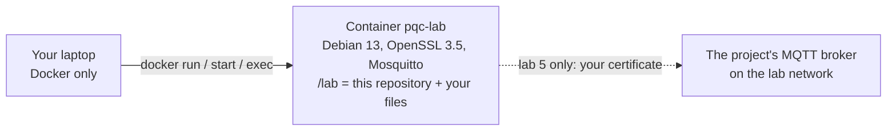
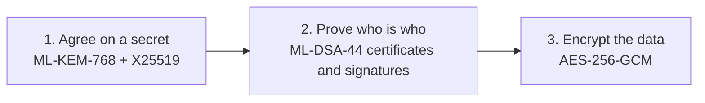

# Learning post-quantum TLS with this project

Eight hands-on labs. By the end you can explain, with your own captures and measurements:

- where every post-quantum algorithm in this project comes from (we write none of them);
- how the keys and certificates are made, and who keeps which private key;
- what happens on the wire, from TCP to TLS 1.3 to MQTT, and where the key exchange (ML-KEM) and the signatures
  (ML-DSA) sit in it;
- why a handshake fails, from the error alone;
- how our system is wired, and which links are post-quantum today;
- how a LoRaWAN frame is built and checked, and what our 256-bit layer adds inside it;
- what each algorithm, handshake and frame costs in time and bytes, on a laptop and on the Pico W.

**How each lab works: predict → run → check.** Every step asks a question first. Write your guess down, run the
commands, then open the folded answer. A wrong guess you can explain teaches more than a right one you can't.

## Setup (once, about 5 minutes)

Everything runs in a plain Debian 13 container, so every laptop gives the same results: all you install is Docker
(Docker Desktop on Windows; on Windows, type the `docker` commands in PowerShell or Windows Terminal). The repository
is cloned inside the container, so nothing else goes on your laptop. No Pi or Pico needed until lab 5's last part.



```bash
docker run -it --name pqc-lab -w /lab debian:trixie bash
```

Then, inside the container (the prompt changes to `root@…:/lab#`):

```bash
apt-get update && DEBIAN_FRONTEND=noninteractive apt-get install -y openssl mosquitto mosquitto-clients tcpdump tshark procps \
  xxd gcc libc6-dev libssl-dev git ca-certificates curl
git clone --depth 1 -b onboarding/learn https://github.com/cthyuiii/PQ_MQTT_mTLS_for_IoT_LoRa.git /lab
openssl version          # OpenSSL 3.5.x
```

- Next time: `docker start -ai pqc-lab` (your files are still in `/lab`).
- A second terminal in the same container: `docker exec -it pqc-lab bash`.
- A file out to your laptop, e.g. to open a capture in Wireshark: `docker cp pqc-lab:/lab/hs.pcap .`

## The labs

| Lab | What you do | Time |
|---|---|---|
| [1. Nobody here writes cryptography](01-libraries.md) | find where each algorithm comes from; read our whole ChirpStack change | 15 min |
| [2. Keys and certificates](02-certificates.md) | make two CAs, a broker and a device certificate; seed vs expanded keys | 25 min |
| [3. One handshake, message by message](03-handshake.md) | trace TCP → TLS 1.3 → MQTT; decrypt your own capture | 30 min |
| [4. Break it on purpose](04-break-it.md) | seven failures, each with its exact error | 30 min |
| [5. Our system](05-our-system.md) | who holds which key; your own certificate on the real broker | 30 min |
| [6. A LoRaWAN frame, byte by byte](06-lorawan-frame.md) | decrypt a real frame and check its MIC with `openssl`; tamper, replay, reuse a counter | 25 min |
| [7. LoRaWAN 1.1 and our 256-bit layer](07-lorawan11-e2e.md) | our device code makes a frame; you open it, first as ChirpStack, then as the application | 35 min |
| [8. Benchmarks](08-benchmarks.md) | each algorithm, TLS vs mTLS, key-exchange groups, certificate types, frame costs; then the Pi's and Pico's numbers | 35 min |

## The picture to keep in mind



TLS 1.3 does three jobs in one round trip:

1. **Agree on a secret** (key exchange). We use **X25519MLKEM768**: classical X25519 and post-quantum ML-KEM-768
   together, so an attacker has to break both. This is what stops "record now, decrypt later" with a future
   quantum computer.
2. **Prove who is who** (certificates and signatures). We use **ML-DSA-44** certificates. With **mutual TLS (mTLS)**
   both sides prove it, not only the server.
3. **Encrypt everything after that** with AES-256-GCM, which is already considered safe against quantum computers at
   this key size.

## Words used in the labs

- **KEM** (key encapsulation mechanism): one side publishes a public key; the other uses it to wrap a fresh secret
  (the "ciphertext"); only the private key unwraps it. ML-KEM is the NIST standard (FIPS 203).
- **ML-DSA**: the NIST post-quantum signature standard (FIPS 204). ML-DSA-44 is its smallest set.
- **CA** (certificate authority): a key pair whose signature on a certificate says "this public key belongs to this
  name". Whoever trusts the CA's certificate accepts what it signed.
- **CSR** (certificate signing request): a name plus a public key, signed with the matching private key, sent to the
  CA to be turned into a certificate. It contains no private key.
- **SAN** (subject alternative name): the names and addresses a certificate is valid for; the client checks it.
- **MQTT broker**: the server every IoT device and service connects to; it passes messages between them by topic.
